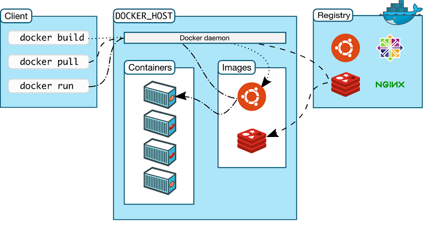
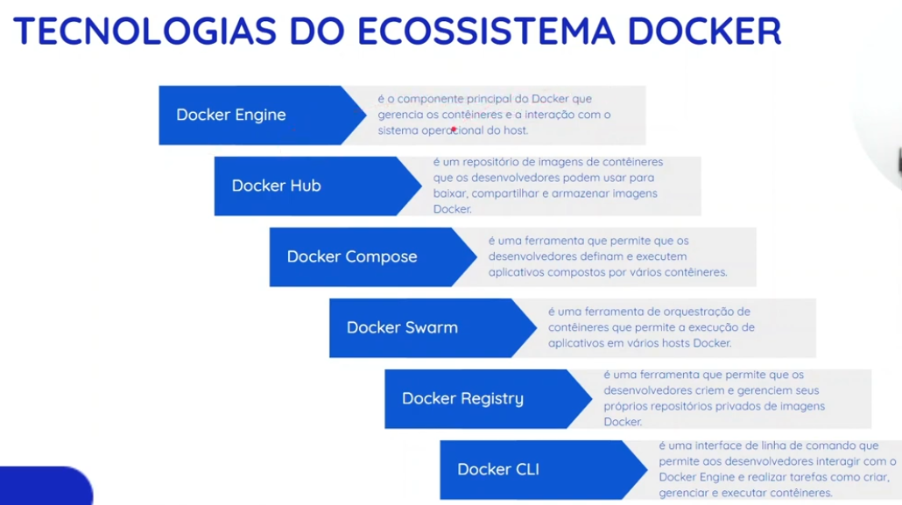

# Arquitetura Docker

### Sumário

- [Definição](#definição)
- [Componentes](#componentes)
- [Tecnologias do ecossistema Docker](#tecnologias-do-ecossistema-docker)

---

#### Definição

---

#### Componentes

---

#### Tecnologias do ecossistema Docker

---
