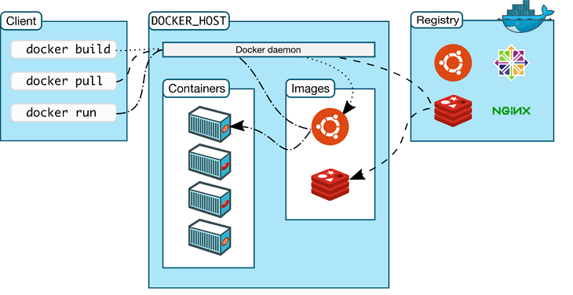
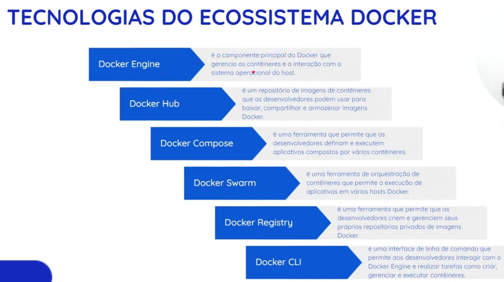
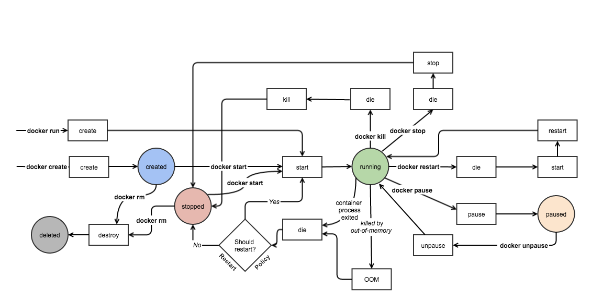

# Arquitetura Docker

### Sumário

- [Definição](#definição)
- [Componentes](#componentes)
    - [docker CLI](#docker-cli)
    - [dockerd](#dockerd)
    - [Container Runtimes](#container-runtimes)
        - [containerd](#container-runtimes)
        - [runc](#container-runtimes)
    - [Docker Registry](#docker-registry)
        - [Docker Hub](#docker-registry)
    - [Objetos do Docker](#objetos-do-docker)
        - [Imagens](#objetos-do-docker)
        - [Containers](#objetos-do-docker)
        - [Networks](#objetos-do-docker)
        - [Volumes](#objetos-do-docker)
- [Tecnologias do ecossistema Docker](#tecnologias-do-ecossistema-docker)
- [Ciclo de vida Docker](#ciclo-de-vida-docker)
- [Pilares do Kernel Linux para o Docker]()
    - [Namespaces](#namespaces)
    - [Union File System/ OverlayFS](#union-file-system--overlayfs)
    - [cgroups](#cgroups)

---

### Definição

A **Arquitetura do Docker** é construída sob um modelo cliente-servidor (client-server) robusto, modular e desacoplado. Quando digita-se um comando no terminal, não está sendo falado diretamente com o container rodando, mas sim orquestrando peças que conversam entre si por meio de APIs REST e componentes de sistema do Linux.

---

### Componentes

Aqui estão os componentes principais que formam a arquitetura do Docker:

#### docker CLI

É a interface principal com a qual interage-se no dia a dia (o comando docker run, docker build, docker ps, etc.).
- O cliente(docker CLI) aceita os comandos digitados pelo administrador da máquina e os traduz em requisições HTTP/REST.
- Essas requisições são enviadas para o Docker Daemon através de um soquete Unix (/var/run/docker.sock) ou de uma API de rede.
- O cliente pode rodar na mesma máquina do servidor ou em uma máquina remota, conversando com o daemon à distância.

#### dockerd

O daemon é o servidor central (o "cérebro" do Docker) que roda em segundo plano no host. É ele quem gerencia todo o ciclo de vida dos objetos do Docker.

- _Ouvinte de API_: Fica escutando as requisições enviadas pelo Docker Client.
- _Gerenciador de recursos_: Coordena imagens, containers, redes (networks) e volumes de armazenamento (volumes).
- Como ele mesmo não executa diretamente as chamadas de baixo nível para o kernel do Linux, ele delega essa parte para runtimes especializados.

#### Container Runtimes

Antigamente, o Docker executava tudo de forma monolítica. Hoje, a arquitetura é altamente modular e separa a gerência de alto nível do motor que efetivamente bota o container para rodar, os container runtimes são considerados o motor de baixo nível:

- **containerd**: É o daemon de gerenciamento de containers de padrão industrial que fica por baixo do Docker. Ele gerencia o ciclo de vida completo dos containers (criação, execução, parada, imagens) na máquina host.
- **runc** (OCI Runtime): É o componente final que interage diretamente com o kernel do Linux. Ele pega as especificações de container da OCI (Open Container Initiative), aciona os [namespaces](#namespaces), os [cgroups](#cgroups) e o [Union filesystem /OverlayFS](#union-file-system--overlayfs), e dá vida ao processo isolado.

#### Docker Registry

É o repositório onde ficam armazenadas as imagens de containers.

- O [Docker Hub](/Docker/Docker_Hub/Docker_Hub.md) é o registro público padrão, mas empresas frequentemente utilizam registros privados locais ou em nuvem (como AWS ECR, Google Artifact Registry ou Harbor).
- Quando se faz um `docker pull` ou `docker push`, o Docker Client/Daemon se comunica via rede com o registro para baixar ou enviar as camadas da imagem.

#### Objetos do Docker

São os componentes estruturais que manipula-se para construir e rodar as aplicações:

- [Imagens](/Docker/Docker_Commands/docker_image/docker_image.md): Templates imutáveis somente leitura que contêm o código, bibliotecas e dependências.
- [Containers](/Docker/Docker_Commands/docker_container/docker_container.md): A instância em execução de uma imagem (o processo isolado).
- [Networks](/Docker/Docker_Commands/docker_network/docker_network.md): O subsistema de rede que permite que containeres se comuniquem entre si e com o mundo exterior de forma isolada.
- [Volumes](/Docker/Docker_Commands/docker_volume/docker_volume.md): Mecanismo de persistência de dados que desacopla os arquivos do ciclo de vida efêmero do container.

---

### Tecnologias do ecossistema Docker

---

### Ciclo de vida Docker

---

### Pilares do Kernel Linux para o Docker

Por trás da interface amigável do Docker e dos comandos simples como [docker run](/Docker/Docker_Comannds_Legacy/docker_run.md), não existe nenhuma tecnologia de virtualização pesada ou hipervisor. O Docker é, na verdade, um mecanismo de empacotamento que orquestra três pilares fundamentais do kernel do Linux: _Namespaces_, _Union File Systems_ e Control Groups (_cgroups_).

Esses três recursos permitem que um processo comum rodando no host seja isolado, tenha sua própria visão de sistema de arquivos e limites rígidos de hardware, parecendo uma máquina virtual, mas compartilhando diretamente o kernel do sistema operacional.

Em resumo, quando roda-se um comando `docker run`, o Docker solicita ao kernel do Linux que crie um novo conjunto de _namespaces_ (isolando rede, processos e montagens), monte as camadas da imagem via _OverlayFS_ com uma camada fina de escrita por cima, e amarre tudo a um _cgroup_ configurado para limitar o consumo de CPU e memória, mais abaixo será mostrado em mais detalhes cada um dos três pilares.

#### Namespaces

Os **Namespaces** isolam os recursos globais do sistema do ponto de vista de um processo. Quando inicia-se um container, o kernel envolve o processo em vários namespaces, fazendo com que ele enxergue apenas o seu próprio mundinho isolado.

Os principais tipos de namespaces usados pelo Docker incluem:

- **PID** (Process ID): Isola a árvore de processos. O processo principal dentro do container recebe o PID 1, tornando-se cego a qualquer outro processo rodando no host ou em outros containers.
- **NET** (Network): Isola as interfaces de rede, tabelas de roteamento, portas TCP/UDP e regras de firewall. Cada container ganha sua própria pilha de rede e endereço IP virtual.
- **MNT** (Mount): Isola os pontos de montagem do sistema de arquivos. O container tem sua própria raiz (/), sem enxergar os diretórios do host, a menos que um volume seja explicitamente compartilhado.
- **IPC** (Inter-Process Communication): Isola recursos de comunicação entre processos (como memória compartilhada e semáforos), impedindo que containers troquem dados por vias nativas do host sem autorização.
- **UTS** (UNIX Timesharing System): Isola o nome de host (hostname) e o domínio NIS, permitindo que o container tenha seu próprio nome sem conflitar com o host.
- **USER** (User ID): Isola os IDs de usuários e grupos (UID e GID), permitindo que um processo rode como root dentro do container, mas seja mapeado para um usuário sem privilégios comuns no sistema operacional hospedeiro.

#### Union File System / OverlayFS

O **Union File System** (atualmente implementado de forma padrão no Linux moderno através do **OverlayFS**) é a tecnologia responsável pelo sistema de arquivos em camadas das imagens Docker.

Ele resolve um problema clássico, que era o de como rodar dezenas de containers baseados na mesma imagem (ex: Ubuntu) sem precisar duplicar gigabytes de dados no disco para cada um.

A arquitetura funciona empilhando camadas do tipo Read-Only (Somente Leitura) sobrepostas por uma camada fina Read-Write (Leitura e Escrita):

- **Camadas de Imagem** (Lower Dir): Contêm o sistema operacional base, dependências e o código da aplicação. Elas são imutáveis e compartilhadas globalmente por qualquer container que utilize aquela mesma imagem.
- **Camada do Container** (Upper Dir): Uma camada superior fina e gravável criada exclusivamente para aquele container no momento em que ele é iniciado.
- **Copy-on-Write** (CoW): Se o container precisar modificar um arquivo que está nas camadas inferiores somente leitura, o OverlayFS intercepta a operação, copia o arquivo original para a camada superior gravável (Upper Dir) e realiza a alteração ali. O arquivo original na imagem base permanece intacto e compartilhado.

#### cgroups

Enquanto os namespaces decidem o que um processo pode ver, os **cgroups** (Control Groups) decidem quanto de hardware (CPU, memória, I/O de disco) esse processo pode consumir. Sem os cgroups, um único container com um loop infinito poderia esgotar toda a RAM ou 100% da CPU do host, derrubando todo o servidor.

O kernel do Linux gerencia isso através de subsistemas chamados controllers:

- **CPU**: Controla o acesso e a quota de tempo de processamento. Você pode limitar um container a usar no máximo 50% de um núcleo de CPU (**--cpu-shares** ou **--cpus**).
- **Memory**: Monitora e impõe limites rígidos de consumo de RAM. Se o container estourar o limite configurado (ex: --memory="512m"), o kernel dispara o mecanismo OOM Killer (Out-of-Memory Killer) e encerra o processo para proteger o host.
- **Blkio** (Block I/O): Define limites de leitura e escrita em discos e partições, evitando que um container realizando muitas consultas sature a controladora de armazenamento.

---
