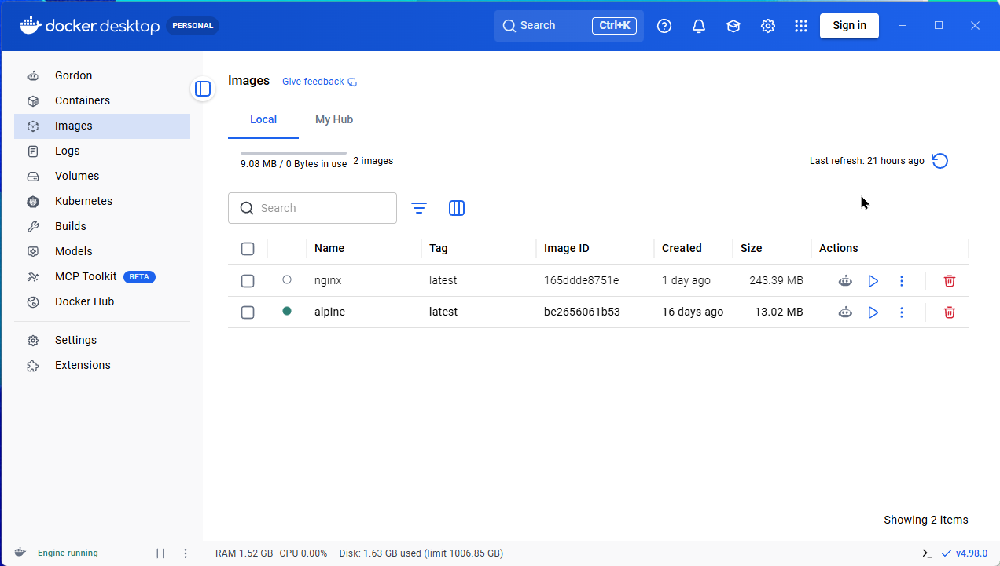

# Docker DESKTOP

### Sumário
- [Descrição](#descrição)
- [Fonte de Pesquisa](#fonte-de-pesquisa)

---

### Descrição

O Docker Desktop é um aplicativo de instalação com um clique para seu ambiente _Mac_, _Linux_ ou _Windows_ que permite criar, compartilhar e executar aplicativos e microsserviços em containeres.

Ele oferece uma interface gráfica intuitiva que permite gerenciar seus containeres, aplicativos e imagens diretamente da sua máquina.

O Docker Desktop reduz o tempo gasto em configurações complexas, permitindo que você se concentre na escrita de código. Ele cuida do mapeamento de portas, das configurações do sistema de arquivos e de outras configurações padrão, além de ser atualizado regularmente com correções de bugs e atualizações de segurança.

O Docker Desktop se integra às suas ferramentas e linguagens de desenvolvimento preferidas e oferece acesso a um vasto ecossistema de imagens e modelos confiáveis ​​por meio do Docker Hub. Isso permite que as equipes acelerem o desenvolvimento, automatizem builds, habilitem fluxos de trabalho de CI/CD e colaborem com segurança por meio de repositórios compartilhados.

---

### Fonte de Pesquisa

- [Docker Desktop](https://docs.docker.com/desktop/)

---
