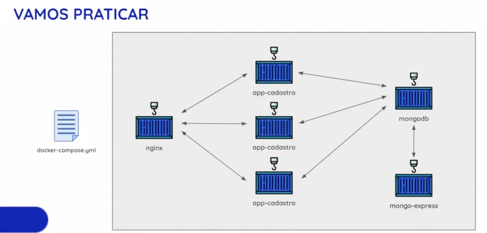

# Docker Project: App de cadastros

---

### Descrição

Neste artigo será mostrado como criar um compose file para o projeto de um app de cadastro que usa a JavaScript, MongoDB e nginx como loadbalance.

Escopo:



Na imagem acima são mostrados três containers chamados app-cadastro, onde eles no [compose.yaml](compose.yaml) são representados pelos services node1, node2 e node3.


Serão criados três Dockerfiles:
```bash
# 
```

---
