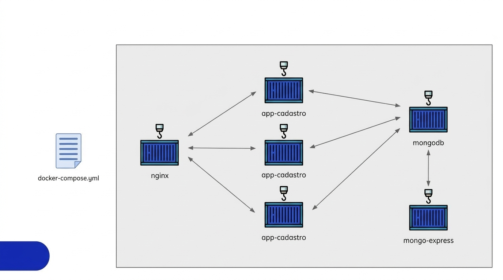
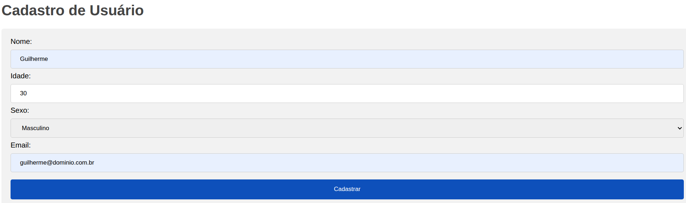
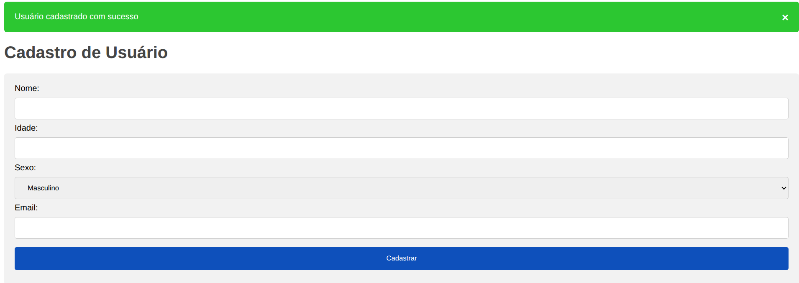
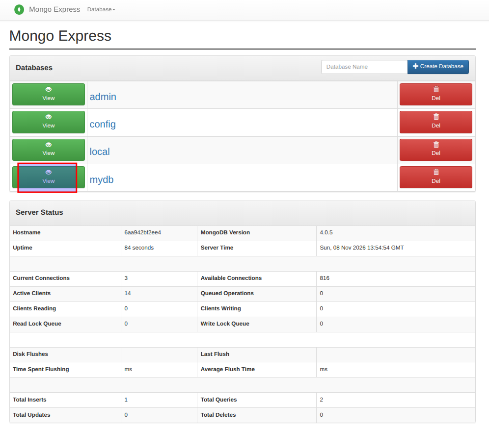
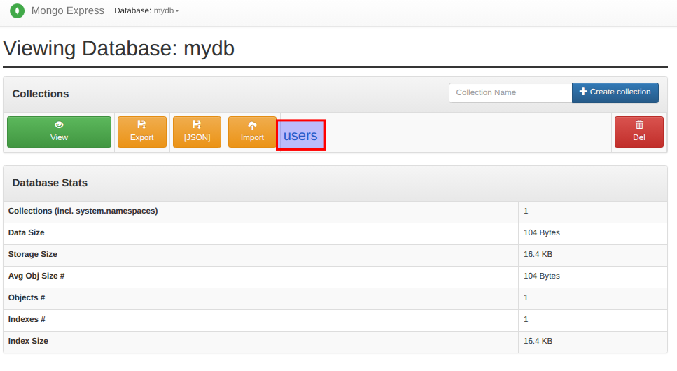
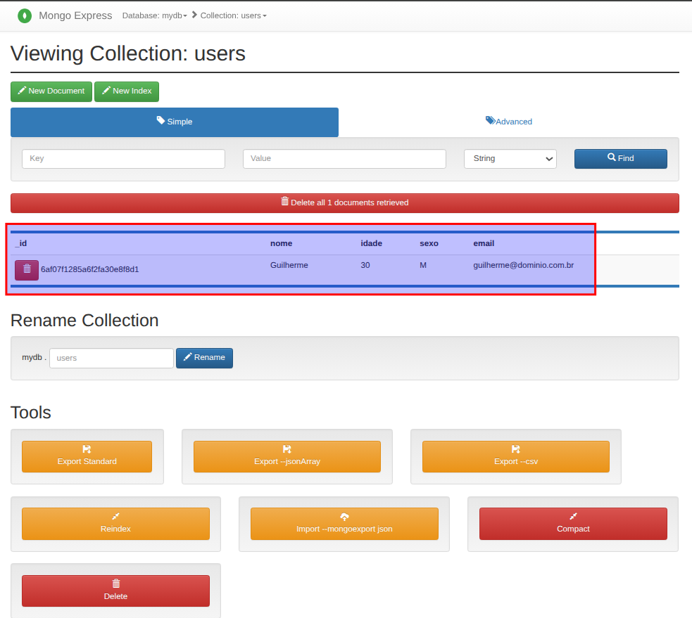

# Docker Project: App de cadastros

### Sumário
- [Descrição](#descrição)
- [Estrutura do Projeto](#estrutura-do-projeto)
- [Demonstração](#demonstração)

---

### Descrição

Projeto de uma página web para cadastro de usuários desenvolvido em NodeJS, MongoDB e nginx como loadbalance, tudo em containers docker.

---

### Estrutura do Projeto

Pastas:
- [app_cadastro](/Docker/Docker_Projects/app_cadastro/)
    - [public](public/)
        - [style.css](public/style.css)
    - [views](views/)
        - [index.ejs](views/index.ejs) 
    - [app.dockerfile](app.dockerfile)
    - [app.js](app.js)
    - [compose.yaml](compose.yaml)
    - [mongo-express.dockerfile](mongo-express.dockerfile)
    - [mongodb.dockerfile](mongodb.dockerfile)
    - [nginx.conf](nginx.conf)
    - [package.json](package.json)
    - [package-lock.json](package-lock.json)
    - [README.md](README.md)
   
---

### Demonstração

Escopo:



Na imagem acima são mostrados três containers chamados app-cadastro, onde eles no [compose.yaml](compose.yaml) são representados pelos services node1, node2 e node3.

Para executar este projeto, rodar na raiz do projeto, onde encontra-se o arquivo compose.yaml:

`docker compose up -d`

Conferindo o que foi criado:

```bash
docker image ls
docker container ls -a
docker network ls
docker volume ls
```

Para verificar se aplicação está funcionando basta acessar o navegador e digitar:

`http://ip_da_vm` ou `http:localhost`

Neste momento já pode-se realizar um cadastro:



Mostrando que o cadastro foi realizado com sucesso:




Para verificar se o balancemento de carga está ocorrendo com sucesso, basta acompnhar os logs via `docker compose logs -f`, a cada vez que a página for ataulizada(F5) ela irá sair por um container diferente, podendo ser node1, node2 ou node3.

Obs: O comando _docker compose logs -f_, precisa ser executado na raiz do projeto, local onde está o arquivo compose.yaml.

Para acessar o mongo express e confirmar que o cadastro realmente foi salvo acessar o endereço abaixo via navegador:
`http://ip_da_vm:8081`

Clicar em _View_:



Clicar em _users_:



Mostrando que realmente a informação foi salva:



---
