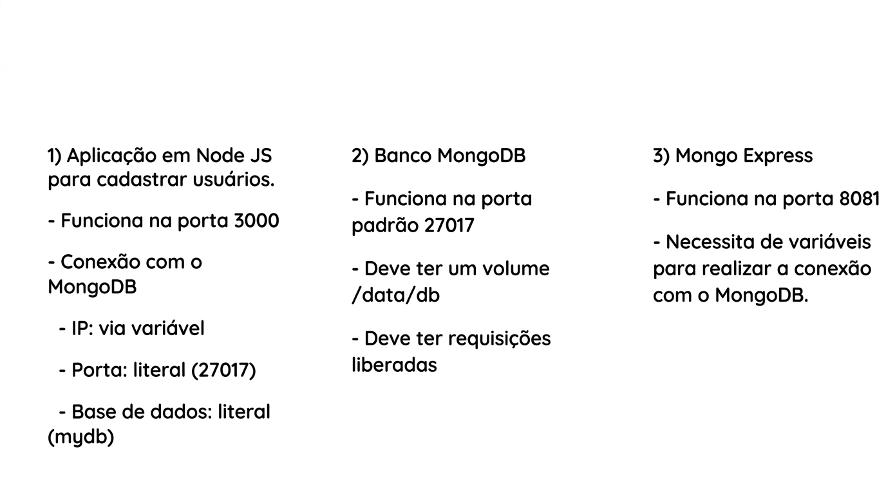

# Migrando App Local para Container 

### Sumário
- [Descrição](#descrição)
- [Prática](#prática)

---

### Descrição

Neste artigo será mostrado como migrar uma aplicação local para um container docker.

---

### Prática

Escopo do desafio:


Repositório do projeto:
https://github.com/techeducabr/curso-docker-essencial-user-registration

Serão criados três Dockerfiles:
```bash
cd /

git clone https://github.com/techeducabr/curso-docker-essencial-user-registration.git

cd /curso-docker-essencial-user-registration/user-registration

# Criando os três Dockerfile
touch app.dockerfile mongodb.dockerfile mongodb-express.dockerfile
```

Editando o mongodb.dockerfile:
```dockerfile
# vim mongodb.dockerfile
FROM alpine:3.9
RUN apk add --no-cache mongodb
EXPOSE 27017
VOLUME /data/db
CMD [ "mongod", "--bind_ip", "0.0.0.0" ]
```


Editando o mongo-express.dockerfile:
```dockerfile
# vim mongo-express.dockerfile
FROM mongo-express:0.54
EXPOSE 8081
ARG MONGO=$MONGOIP
ENV ME_CONFIG_MONGODB_SERVER=$MONGO
ENV ME_CONFIG_MONGODB_PORT=27017
```
Obs: No arquivo _mongodb-express.dockerfile_ **iria** ser adotada uma prática não muito boa, que é definir um IP para um container, visto que containers tendem a serem criados e destruídos constantemente e podem receber IPs diferentes, uma solução de contorno foi criar um ARGumento de nome MONGO. 

Editando o app.dockerfile:
```dockerfile
# vim app.dockerfile
FROM node:20.3.0-alpine3.18
WORKDIR /app
ARG MONGO=$MONGOIP
ENV MONGODB=$MONGO
EXPOSE 3000
COPY package-lock.json .
COPY package.json .
RUN npm install
COPY . .
CMD [ "node", "app.js" ]
```

Voltando para os comandos:
```bash
# Fazendo o build do mongodb
docker build -t meu-mongodb -f mongodb.dockerfile .

# Mostrando que a imagem de nome meu-mongodb foi criada:
docker image ls

docker run -dit -p 27017:27017 --mount source=vol-mongo,target=/data/db --name meu-mongo meu-mongodb

docker container ls -a

# Para descobrir o IP do Container:
docker inspect meu-mongo
# Obs: Em "Networks" foi visto que atualmente o "IPAddress" é 172.17.0.8.

# Exportando o valor do IP do container para a variável de ambiente MONGOIP:
export MONGOIP=172.17.0.8

echo $MONGOIP

# Construindo uma imagem com nome meu-mongo-express, o --build-arg é usado para definir o ARGumento que no caso tem o nome MONGO e o $MONGOIP é a variável de ambiente, que acabou de ser definida com o valor do IP do container meu-mongo:
docker build -t meu-mongo-express -f mongo-express.dockerfile --build-arg MONGO=$MONGOIP .

# Construindo uma imagem com nome meu-app-node, o --build-arg é usado para definir o ARGumento que no caso tem o nome MONGO e o $MONGOIP é a variável de ambiente, recém definida com o valor do IP do container meu-mongo:
docker build -t meu-app-node -f app.dockerfile --build-arg MONGO=$MONGOIP .

# Mostrando as três imagens que foram construídas:
docker image ls

docker run -dit -p 8081:8081 --name cont-mongo-express meu-mongo-express
# Obs: Para testar se o container está em execução pode-se olhar no navegador usando http://ip_da_vm:8081

# Subindo o terceiro e último container:
docker run -dit -p 3000:3000 --name cont-app-node meu-app-node
# Obs: Para testar se o container está em execução pode-se olhar no navegador usando http://ip_da_vm:3000

docker container ls -a
```

--

Focando agora em otimizar o uso da rede no projeto, por meio do docker network.

Editando o app.dockerfile:
```dockerfile
# vim app.dockerfile
# Obs: Removida a linha: "ARG MONGO=$MONGOIP"
# Obs2: Editada a linha: "ENV MONGODB=meu-mongodb"
FROM node:20.3.0-alpine3.18
WORKDIR /app
ENV MONGODB=meu-mongodb
EXPOSE 3000
COPY package-lock.json .
COPY package.json .
RUN npm install
COPY . .
CMD [ "node", "app.js" ]
```

Editando o mongo-express.dockerfile:
```dockerfile
# vim mongo-express.dockerfile
# Obs: Removida a linha: "ARG MONGO=$MONGOIP"
# Obs2: Editada a linha: "ENV ME_CONFIG_MONGODB_SERVER=meu-mongodb"
FROM mongo-express:0.54
EXPOSE 8081
ENV ME_CONFIG_MONGODB_SERVER=meu-mongodb
ENV ME_CONFIG_MONGODB_PORT=27017
```

Voltando para os comandos:
```bash
# Fazendo o build do mongodb novamente:
docker image build -t meu-mongodb:v1 -f mongodb.dockerfile .

# Fazendo o build do mongo-express novamente:
docker image build -t meu-mongo-express:v1 -f mongo-express.dockerfile .

# Fazendo o build do app novamente:
docker image build -t meu-app-node:v1 -f app.dockerfile .

docker image ls

# Criando a rede para os containers se comunicarem por nome:
docker network create --driver bridge minha-rede
# Obs: Criada a rede de nome minha-rede com o driver em modo bridge.
docker network ls

docker container run -dit --name meu-mongodb -p 27017:27017 --network minha-rede --mount source=volume-teste,target=/data/db meu-mongodb:v1

docker container run -dit --name meu-mongo-express -p 8081:8081 --network minha-rede meu-mongo-express:v1

docker container run -dit --name meu-app-node -p 3000:3000 --network minha-rede meu-app-node:v1

docker container ls -a
```


---