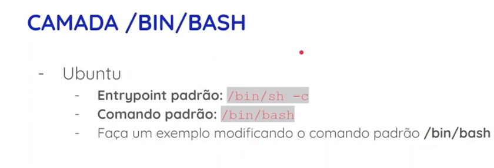

# ENTRYPOINT

### Sumário
- [Descrição](#descrição)
- [Exemplo](#exemplo)
- [ENTRYPOINT vs CMD](#entrypoint-vs-cmd)
- [Prática](#prática)

---

### Descrição

O ENTRYPOINT é uma instrução utilizada em um Dockerfile que define o _comando principal_ e _executável fixo_ que será executado sempre que um container for iniciado a partir daquela imagem.

Pode-se pensar nele como o "programa principal" do seu container. Se for criada uma imagem para rodar um script em Python, por exemplo, o ENTRYPOINT garante que o interpretador Python será acionado por padrão, impedindo que o container feche imediatamente após iniciar.

---

### Exemplo

Imagine o seguinte trecho em um Dockerfile:

```
FROM python:3.11-slim
COPY script.py /app/script.py
WORKDIR /app
ENTRYPOINT ["python", "script.py"]
```

Quando você executar o container com docker run minha-imagem, o Docker automaticamente rodará python script.py.

---

### ENTRYPOINT vs CMD

Muitas vezes o ENTRYPOINT é confundido com o CMD. A diferença principal está em como eles lidam com argumentos e sobreposições:

- **ENTRYPOINT**: Define o executável fixo. Os argumentos passados na linha de comando (docker run) são anexados ao ENTRYPOINT.
- **CMD**: Define argumentos padrão, que podem ser facilmente sobrescritos inteiramente por qualquer comando que você digitar ao rodar o container.


Imagine o seguinte trecho em um Dockerfile:

```
FROM ubuntu
ENTRYPOINT ["ping"]
CMD ["localhost"]
```

- Se você rodar apenas `docker run minha-imagem`, o container executará: `ping localhost`.
- Se você rodar `docker run minha-imagem 8.8.8.8`, o argumento sobrescreve o CMD, e o container executará: `ping 8.8.8.8`.

---

### Prática




Mostrando como mudar o comando padrão:

```bash
# Subindo um container com o Comando /bin/bash baseado na imagem do ubuntu:
docker run -dit --name container-1 ubuntu

# Mostrando que o container-1 já vem com o Comando /bin/bash:
docker container ls -a

# Definindo o comando padrão como 'ls' ao invés de /bin/bash:
docker run -dit --name container-2 ubuntu ls

# Mostrando que o container-2 já vem com o Comando 'ls':
docker container ls -a
```

---
